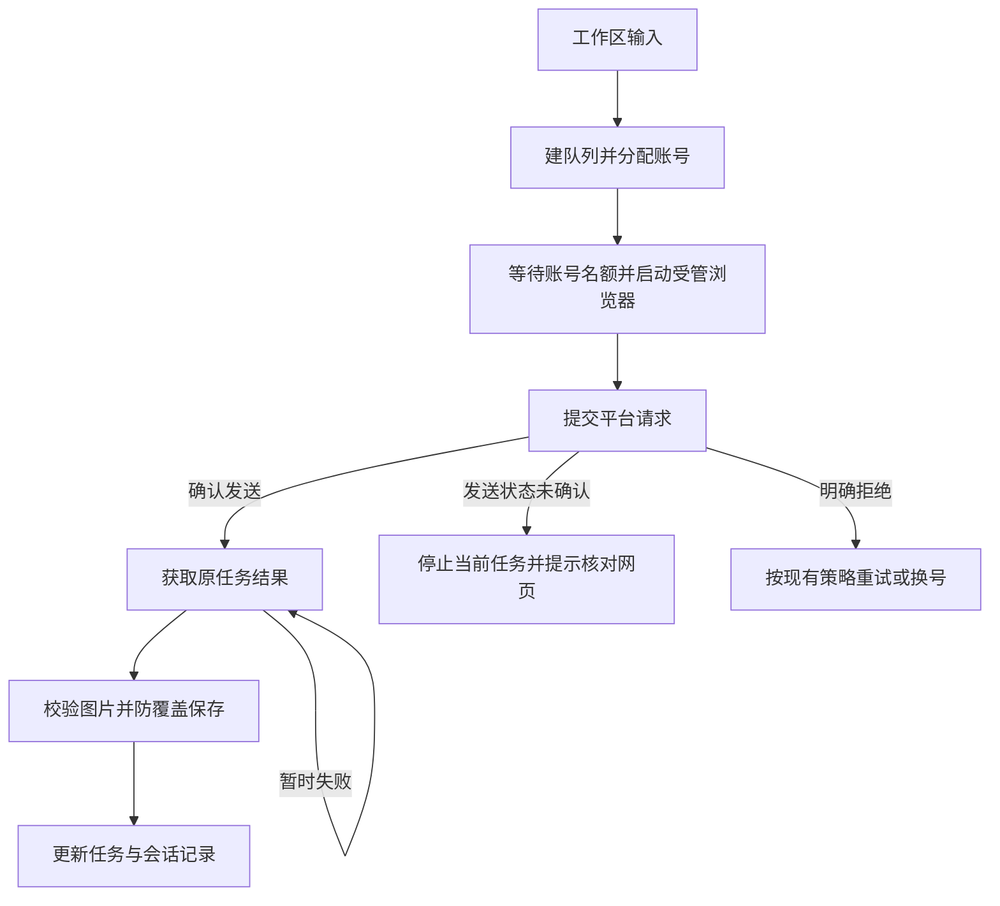

# 核心任务执行与恢复设计

任务恢复以提交边界为准。发送状态未确认时停止自动尝试；已确认发送后保留原账号和结果。工作区切换以保存成功为前提，停止任务的信号贯穿账号启动等待。

## 应用架构与模块职责

桌面端基于 Go 与 MyGo v0.10.0（[`mygo.json`](../mygo.json)、[`cmd/tulai/main.go`](../cmd/tulai/main.go)）构建，前端采用 React 19 + Vite 6 + Tailwind CSS v4 + TypeScript 5（[`frontend/`](../frontend/)），由 `go tool mygo build` 通过 `-overlay` 打包嵌入可执行文件。

- **绑定生成快速路径（`MYGO_GENERATE`）**：[`cmd/tulai/main.go`](../cmd/tulai/main.go) 检测到 `MYGO_GENERATE` 环境变量时，仅调用 `ui.RegisterBindingsOnly()` 与 `mygo.App.Run()` 生成 [`frontend/src/mygo.ts`](../frontend/src/mygo.ts)，跳过配置库、日志与数据目录初始化。
- **单协程 Controller Actor 与 9 个 IPC 服务**：[`internal/ui/actor.go`](../internal/ui/actor.go) 启动单协程消息循环（`App.StartActor` / `App.call`），串行化所有 IPC 状态读写与后台回调，避免 `internal/ui/*_ops.go` 细粒度锁竞争。[`internal/ui/host.go`](../internal/ui/host.go) 向 MyGo 绑定 `Core`、`Workbench`、`Browser`、`Prompts`、`Download`、`Dedup`、`Rename`、`ImageEdit`、`Settings` 共 9 个领域服务，通过合并去重的 `tulai:topics` 事件驱动前端 Zustand store（[`frontend/src/store/`](../frontend/src/store/index.ts)）增量刷新，并用 `tulai:file-drop` 事件传递操作系统原生文件路径拖放。
- **本地媒体协议（`tulaimedia`）**：[`internal/ui/media_handler.go`](../internal/ui/media_handler.go) 通过 `mygo.Protocol.Handle("tulaimedia", ...)` 提供不透明随机令牌映射的本地图片服务、动态缩放缩略图 LRU 缓存（64 MiB 上限），以及实时缓冲流（`/drawer/frame`、`/edit/orig`、`/edit/preview`、`/brand-icon`）。Windows WebView2 使用 `http://tulaimedia.localhost`，macOS WKWebView 与 Linux WebKitGTK 使用 `tulaimedia://localhost`。
- **任务、策略与受管浏览器**：
  - 工作区（[`internal/ui/workbench_ops.go`](../internal/ui/workbench_ops.go)）负责收集输入和保存会话。
  - `tasks.Engine`（[`internal/tasks/engine.go`](../internal/tasks/engine.go)）负责建队列、并发名额、账号健康和恢复决策。
  - 平台策略层（[`internal/strategy/`](../internal/strategy/strategy.go)）负责豆包、千问的页面交互、发送提交与结果提取。
  - `browser.Manager`（[`internal/browser/browser.go`](../internal/browser/browser.go)）统一管理受管 Fingerprint（`fingerprint-chromium`，[`internal/fingerprint/`](../internal/fingerprint/install.go)、[`internal/cdp/`](../internal/cdp/client.go)）的账号进程、独立资料目录与启动串行化。图片校验和防覆盖保存继续使用现有公共路径。

停止或任务时限会结束启动等待和结果获取。人工验证使用独立的等待时限，用户停止仍优先。已成功启动的账号进程由 Manager 管理，批次收尾通过既有关闭流程保存登录资料。会话初始化仍有独立的等待预算，取消启动后也需要完成进程清理，因此停止完成不保证即时。

账号浏览器随时可能由用户直接关闭窗口，所以进程退出以进程本身为准：Manager 在进程结束后摘掉账号记录并通知界面，界面据此清掉运行标记、结束登录轮询并把账号行从「停止」换回「打开」。主动停止和换形态重开由应用自己摘掉记录，不会上报成关窗口。

## 恢复规则

| 边界 | 行为 | 实现位置 |
|---|---|---|
| 发送已尝试但未确认 | 仅结束当前任务，保留错误与已保存结果；错误同时包含网络、验证码、额度等信息时也不能进入自动重发 | `tasks.execute`（[`internal/tasks/engine.go`](../internal/tasks/engine.go)） |
| 已确认发送后出现账号故障 | 更新账号健康，保留本任务的账号及提交状态；后续未提交任务可选其他账号 | `tasks.maybeRotate`（[`internal/tasks/rotate.go`](../internal/tasks/rotate.go)） |
| 平台明确返回回复异常或审核拒绝 | 按各平台已有次数限制处理。已提交任务不能仅凭普通错误文本清空提交状态 | `tasks.execute` 与 `softenModeration`（[`internal/tasks/engine.go`](../internal/tasks/engine.go)、[`internal/tasks/failhint.go`](../internal/tasks/failhint.go)） |
| 保存失败 | 中止本次启动，保留当前草稿、队列、会话 ID 和错误日志 | `ui.persistWorkspace`（[`internal/ui/workbench_ops.go`](../internal/ui/workbench_ops.go)） |
| 重启后恢复当前会话 | 将活动态、空值和未知状态改为“需核对”，保留原账号、结果、错误和终态；批量失败重试跳过这些任务，单项需主动选择“核对后重新生成” | `ui.queueFromSession`、`applySession`、`tasks.RebuildRetry`（[`internal/ui/workbench_ops.go`](../internal/ui/workbench_ops.go)、[`internal/tasks/tasks.go`](../internal/tasks/tasks.go)） |
| 启动或重试尚未建立新队列就失败 | 保留原队列、结果和进度，不把上一批的引擎快照写入当前工作区；初始保存失败时中止启动 | `ui.runQueue`（[`internal/ui/workbench_ops.go`](../internal/ui/workbench_ops.go)） |
| 等待同账号启动、启动请求或初始导航时停止 | 使用调用方 context 结束等待；正常登录入口仍由自身超时控制 | `browser.Manager.start`（[`internal/browser/browser.go`](../internal/browser/browser.go)） |

实现复用现有提交标记、错误类型、调度器和 SQLite 会话存储。无需增加通用工作流引擎或新的持久化结构。用户主动重试仍沿用现有行为；发送未确认时，失败提示要求先检查原账号网页，按钮显示“核对后重试”。

重新打开后的当前会话没有完整提交上下文，因此“需核对”表示结果尚待人工确认，不会自动续发。单项“核对后重新生成”创建新的生成任务。恢复时会重新计算进度并清除旧的运行文案，已经保存的图片仍保留。

## 回归依据

- [`internal/tasks/rotate_test.go`](../internal/tasks/rotate_test.go) 覆盖多平台不确定发送及复合错误；[`internal/tasks/captcha_wait_test.go`](../internal/tasks/captcha_wait_test.go) 覆盖人工验证独立等待与出图时限的组合。
- [`internal/browser/cancel_start_test.go`](../internal/browser/cancel_start_test.go) 用私有管道夹具验证取消启动和独立进程生命周期，不启动真实浏览器；[`internal/browser/exit_test.go`](../internal/browser/exit_test.go) 用同一夹具验证用户关窗口会通知界面、主动停止和换形态重开不会。
- [`internal/ui/browser_exit_test.go`](../internal/ui/browser_exit_test.go) 验证界面收到退出后清掉运行标记、结束登录轮询并刷新账号行；[`internal/ui/recovery_boundary_test.go`](../internal/ui/recovery_boundary_test.go) 覆盖跨页旧快照、初始保存失败与启动失败后的记录保留；[`internal/ui/actor_test.go`](../internal/ui/actor_test.go) 与 [`internal/ui/media_handler_test.go`](../internal/ui/media_handler_test.go) 覆盖单协程 Actor 串行化与 `tulaimedia` 本地媒体协议（原有在 v0.1.34 界面迁移时移除的 SQLite 故障注入会话恢复用例尚未重新迁回）。

复审期间发现，人工验证结束时任务的出图 deadline 可能已经过去。因此，人工验证超时仍须保留“待验证”语义；不能统一按出图超时覆盖。
