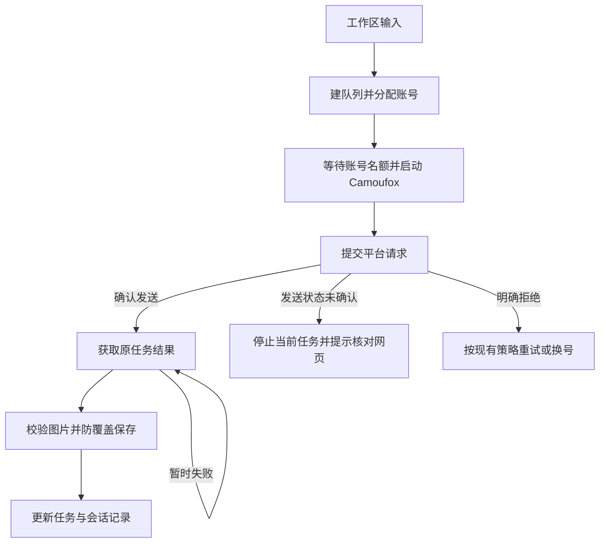

# 核心任务执行与恢复设计

任务恢复以提交边界为准。发送状态未确认时停止自动尝试；已确认发送后保留原账号和结果。工作区切换以保存成功为前提，停止任务的信号贯穿账号启动等待。

## 职责与流程

工作区负责收集输入和保存会话。`tasks.Engine` 负责建队列、并发名额、账号健康和恢复决策。平台实现负责提交与读取结果。`browser.Manager` 负责 Camoufox 账号进程、资料目录与启动串行化。图片校验和防覆盖保存继续使用现有公共路径。

停止或任务时限会结束启动等待和结果获取。人工验证使用独立的等待时限，用户停止仍优先。已成功启动的账号进程由 Manager 管理，批次收尾通过既有关闭流程保存登录资料。会话初始化仍有独立的等待预算，取消启动后也需要完成进程清理，因此停止完成不保证即时。

## 恢复规则

| 边界 | 行为 | 实现位置 |
|---|---|---|
| 发送已尝试但未确认 | 仅结束当前任务，保留错误与已保存结果；错误同时包含网络、验证码、额度等信息时也不能进入自动重发 | `tasks.execute` |
| 已确认发送后出现账号故障 | 更新账号健康，保留本任务的账号及提交状态；后续未提交任务可选其他账号 | `tasks.maybeRotate` |
| 平台明确返回回复异常或审核拒绝 | 按各平台已有次数限制处理；ChatGPT 审核拒绝直接失败。已提交任务不能仅凭普通错误文本清空提交状态 | `tasks.execute` 与 `softenModeration` |
| ChatGPT 已知输出暂时 404 | 继续查询原会话，全部已知输出就绪后才返回成功；超时保留原生成状态供本次应用运行内重试 | `chatgpt.Results` |
| 保存或归档失败 | 中止本次新建或恢复操作，保留当前草稿、队列、会话 ID 和错误日志 | `ui.persistWorkspace`、`newWorkspace`、`reopenSession` |
| 重启或恢复历史任务 | 将活动态、空值和未知状态改为“需核对”，保留原账号、结果、错误和终态；批量失败重试跳过这些任务，单项需主动选择“核对后重新生成” | `ui.queueFromSession`、`applySession`、`tasks.RebuildRetry` |
| 恢复当前会话或切换历史失败 | 当前会话先保存内存编辑；历史切换复用活动会话事务，激活失败时保留当前活动记录 | `ui.reopenSession`、`store.ActivateSession` |
| 启动或重试尚未建立新队列就失败 | 保留原队列、结果和进度，不把上一批的引擎快照写入当前工作区；初始保存失败时中止启动 | `ui.runQueue` |
| 等待同账号启动、启动请求或初始导航时停止 | 使用调用方 context 结束等待；正常登录入口仍由自身超时控制 | `browser.Manager.start` |
| Antigravity 额度查询等待凭据锁 | 等锁、凭据切入与查询共用一个超时预算；取消或超时不再进入后续查询 | `agy.fetchUsage` |
| 额度命令异常退出 | 即使输出含可解析的额度，也返回查询失败；错误提示不包含命令原始输出 | `agy.captureUsage`、`fetchUsage` |
| 重新登录或导入账号 | 作废旧身份的在途查询，并原子协调登录状态、账号健康和额度缓存；首单刷新期间身份变化则等待新身份的读取 | `ui.resetAgyUsage`、`fetchAgyAccount`、`refreshAgyUsageBeforeRun` |

实现复用现有提交标记、错误类型、调度器和 SQLite 会话存储。无需增加通用工作流引擎或新的持久化结构。用户主动重试仍沿用现有行为；发送未确认时，失败提示要求先检查原账号网页，按钮显示“核对后重试”。

历史记录没有完整提交上下文，因此恢复后的“需核对”表示结果尚待人工确认，不会自动续发。单项“核对后重新生成”创建新的生成任务。恢复时会重新计算进度并清除旧的运行文案，已经保存的图片仍保留。

额度查询结束后，保存刷新凭据和错误恢复仍使用独立清理预算，避免取消查询时丢失账号凭据。认证失败也先保存已刷新的凭据；保存错误保留在返回值中。清理成功后已被取消的读取不发布晚到的登录错误或额度。因此整个函数的耗时可能超过查询预算。

## 回归依据

`internal/tasks/rotate_test.go` 覆盖多平台不确定发送及复合错误。人工验证测试覆盖独立等待与出图时限的组合。`internal/browser/cancel_start_test.go` 用私有管道夹具验证取消启动和独立进程生命周期，不启动真实浏览器。`internal/chatgpt/client_test.go` 覆盖文件与附件延迟就绪、永久 404。`internal/ui/session_test.go` 通过关闭数据库和 SQLite 故障注入验证草稿保留，也覆盖生图与洗图历史重启、重复恢复、混合卡片核对入口和原生界面状态。`internal/agy/usage_test.go` 使用虚拟时钟验证等锁期间超时、取消及取得锁后的剩余预算。

`internal/ui/recovery_boundary_test.go` 覆盖当前会话的新编辑、激活历史失败、跨页旧快照、初始保存失败与启动失败后的记录保留。额度测试还覆盖异常退出、认证失败前的凭据刷新、身份切换后的旧响应、取消后的迟到结果，以及首单刷新与后台读取并发时的等待与去重。

复审期间发现，人工验证结束时任务的出图 deadline 可能已经过去。因此，人工验证超时仍须保留“待验证”语义；不能统一按出图超时覆盖。

## 后续设计项

ChatGPT 的文件指针与附件指针若指向同一张图，但其中一个永久不可用，当前会超时。只有取得真实协议中的对应关系后，才能安全合并这两种指针。
